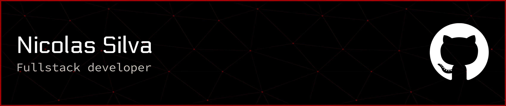

# 👩🏻‍💻 Nicolas Silva

*Desenvolvedor Fullstack*

Me chamo Nicolas Souza Silva, tenho 18 anos e sou natural de São Paulo. Concluí o ensino médio na ETEC com o curso técnico em desenvolvimento de sistemas. Atualmente, estou cursando uma faculdade em Ciência da Computação

    
    <a href="https://www.linkedin.com/in/nicolas-silva-098a783a2/">
        
        

### 🤖 Linguagens e Tecnologias

                   

          

 
 
